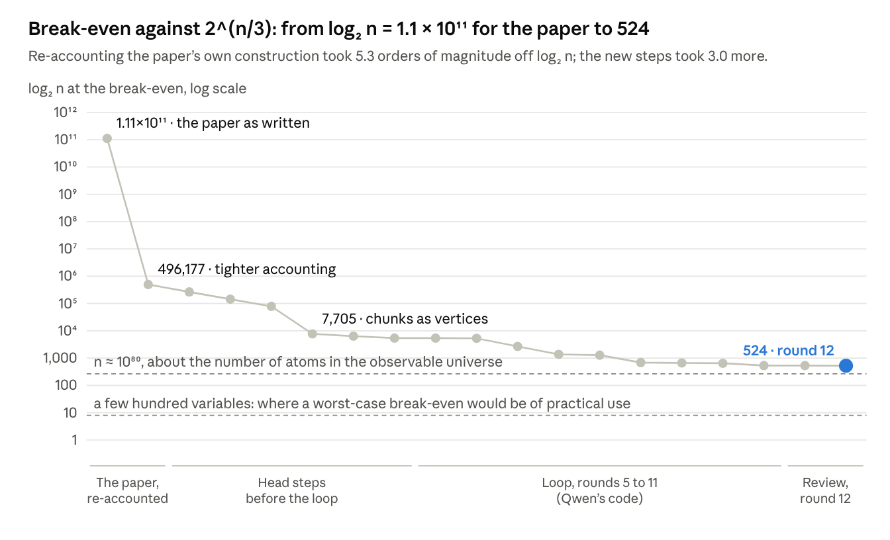
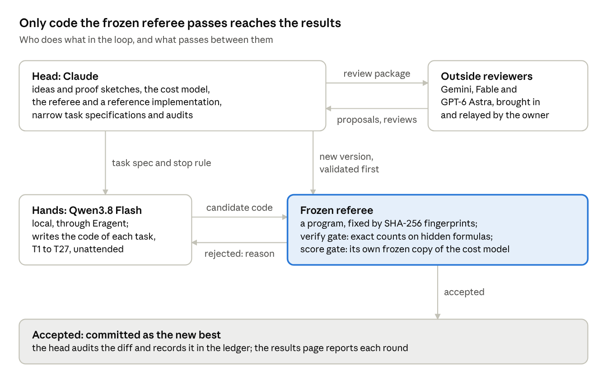

# Break-even sizes of the Appendix D route of "The Exponential Time Hypothesis is False"

[](https://doi.org/10.5281/zenodo.23895434)

From which formula size does the tensor-contraction route in Appendix D of OpenAI's preprint *The Exponential Time Hypothesis is False* (revision of 25 October 2026) beat the best known algorithms? This repository holds the frozen cost model and referee that produced our numbers, the code written in the loop, the ledger of every step and review, the write-up and the results page.

**Short answer.** On 3-CNF formulas in which every variable occurs at most three times, the route's most favourable class, it beats the best counting bound we know for that class, 2^(n/3), only from about 10^158 variables, and brute force from about 10^28. With the paper's own choices the first comparison needed 2^(1.11 × 10^11) variables. These are feasible thresholds of a frozen cost model, not proved minima; our modifications rest on proof sketches, and the paper's theorem is assumed.

| Competitor | What it does, on which formulas | log₂ n after round 12 | n, about |
| --- | --- | --- | --- |
| 2ⁿ (brute force) | counts, all formulas | 92 | 10^28 |
| 1.637ⁿ (Kutzkov, IJCAI 2026) | counts, all formulas | 147 | 10^44 |
| 2^(n/3 + o(n)) (path decomposition) | counts, at most three occurrences | **524** | 10^158 |
| 1.307ⁿ (PPSZ) | decides, all formulas | 403 | 10^121 |
| 1.1199ⁿ (Jain, Neoh and Stephan) | decides, at most three occurrences | 2,032 | 10^612 |

- Write-up: [`paper/eth-break-even-appendix-d.md`](paper/eth-break-even-appendix-d.md), also as [PDF](paper/eth-break-even-appendix-d.pdf).
- Results page with every round, its tables and the history: [`results/results_page.html`](results/results_page.html) (download it and open it in a browser).



## Check the numbers

The cost model and the referee use only the Python standard library (Python 3.12 was used; 3.13 also works).

```
python check_certificates.py
```

re-checks every cell in the frozen cost model in well under a second. Each certificate in `work/head/r12/round12_witnesses.json` must be valid at its size with an exponent below the competitor's, and must fail one size below. The script also prints the model's SHA-256 (version 8: `67262791…ffe60514`).

```
python -I referee_appd/referee.py algo_appd out.json
```

runs the whole referee on the committed code, in about seven minutes. Its verify gate runs the code on hidden formulas and nodes and compares exact counts, reference values, call counts and matrix shapes. Its score gate then re-scores the committed parameter search, bisecting log₂ n from 64 to 10^9. It gives 93, 147, 525, 404 and 2,033 in the table's order; the table's cells, one lower in four columns, are the best of three searches, each certificate checked in the same frozen file.

```
python work/head/r12/whatif_dens_v8.py 4.26 out.json brute,sharp3sat,ppsz
```

recomputes the general-formula entries at clause density 4.26 in about six minutes (use 5.0 for the other row).

## What is in the repository

| Folder | What it holds |
| --- | --- |
| `referee_appd/` | The frozen referee of the Appendix D route: `referee.py`, its gates `appd_gates.py`, the cost model `appd_assembly.py` (version 8), the reference implementation `appd_ref.py` and the hidden cases `cases_appd.json` |
| `algo_appd/` | The code the hands wrote (`appd_core.py`, `appd_params.py`), their self-checks and a read-only public copy of the model |
| `state/` | The ledger `claims.md` (every step with its proof sketch, every check, every outside review and our answers), the best scores, the task backlogs, the iteration logs and the referee fingerprints |
| `loop/` | The loop driver (`loop.py`, `loop_appd.py`), its task and agent templates and the Windows launch scripts |
| `work/head/r12/` | Round 12: the certificates, the threshold scan, the density computation, the model patch and its validation |
| `paper/` | The write-up as Markdown and PDF, with its figures |
| `results/` | The results page |
| `reviews/round11-hostile-review/` | The hostile review of round 11 by GPT-6 Astra: our request, her report, her independent checker and her parameter search |
| `algo/`, `referee/` | The loop's first route (rounds 1 to 4), the paper's main construction; it reached log₂ n = 10,086 against PPSZ before the work moved to Appendix D |

## How the numbers were produced



The head (Claude) wrote the ideas, the proof sketches, the cost model, the referee, a reference implementation and narrow task specifications. The hands (Qwen3.8 Flash, run locally through the Eragent harness) wrote the code: tasks T1 to T27 in eleven rounds, unattended on the owner's PC. A frozen referee, fixed by SHA-256 fingerprints, ran every candidate on hidden exact-count tests and re-scored its parameters with its own copy of the model; a step counted only after its code passed. Outside reviewers (Gemini, Fable and GPT-6 Astra) proposed steps and probed the proofs; every accepted and rejected point is in `state/claims.md`. The git history is the loop's own: every accepted change was committed when it passed.

To run the loop again you need an agent that edits files in a workspace (the driver calls the Eragent CLI, which is not included) and an OpenAI-compatible model server. `loop/loop.py` and the `.cmd` files carry the owner's Windows paths. The hidden cases in `referee_appd/` are public now, so a blind rerun should keep the referee outside the agent's workspace, as the driver does, and use new cases.

## Status of the claims

- The correctness of the paper's Appendix D construction is assumed.
- The code of the ten code-dependent steps is checked by the referee on small instances, and the model's constants are checked in exact integer arithmetic. The cost bounds and size conditions of the steps are head-level proof sketches, not peer reviewed.
- The thresholds are feasible values found by search, not proved minima. Polynomial factors and tensor-entry costs are dropped; at every cell the margin exceeds their scale by a factor of at least 2^46.
- The contraction steps trade the paper's polynomial memory for tables of about 2^(0.36n) entries at the break-even.
- None of this is practical. At a break-even both bounds are about 2^(n/3) steps, and even the brute-force cell needs more variables than all the world's storage could hold.

## Credits

| Who | Role |
| --- | --- |
| Faruk Eren Çıracıoğlu, Independent Researcher, Türkiye | Owner of the project. When the work stalled, he kept it moving by seeking new routes and outside reviewers, whose proposals became the steps of rounds 7, 8, 10, 11 and 12. He ran the loop on his PC and relayed the reviews. |
| Claude (Anthropic; Opus 5.5) | Head: cost model, proofs and proof sketches, referee and reference implementation, task specifications, audits, searches, results page, write-up |
| Qwen3.8 Flash (local, through Eragent) | Hands: the code of tasks T1 to T27 |
| GPT-6 Astra (OpenAI) | The shell matrix products, the guarded deformation, the binary crossing and the profile orders (rounds 7, 8, 10 and 11); the hostile review and the matching-based balance (round 12) |
| Fable 5.1 (Anthropic) | Review: the fair counting competitor 2^(n/3) and an independent cross-check of the density entry |
| Gemini 4 Argon (Google) | Review: padding per pattern, sums over the chunks' variables, a second recursion level |

## Citation and license

Cite this work as: Faruk Eren Çıracıoğlu (2026), *How far is the ETH refutation from practice? Break-even sizes of the Appendix D route*, version 1.0, Zenodo, [doi:10.5281/zenodo.23895435](https://doi.org/10.5281/zenodo.23895435). The DOI [10.5281/zenodo.23895434](https://doi.org/10.5281/zenodo.23895434) covers all versions and resolves to the latest; the metadata are in [`CITATION.cff`](CITATION.cff). The code is under the MIT license ([`LICENSE`](LICENSE)). The write-up, its figures, the results page and the review texts are under [CC BY 4.0](https://creativecommons.org/licenses/by/4.0/).
