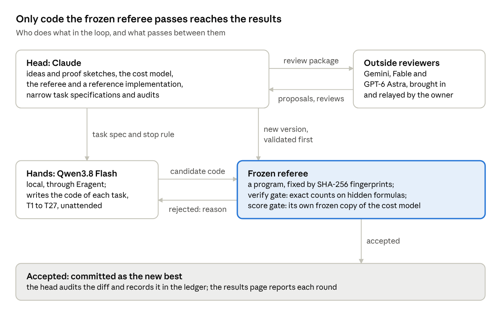
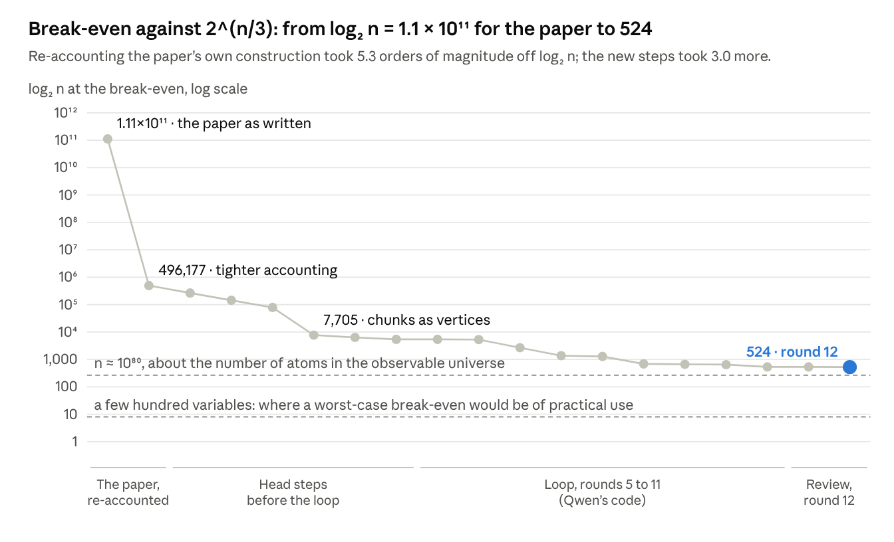

# How far is the ETH refutation from practice? Break-even sizes of the Appendix D route

Faruk Eren Çıracıoğlu, Independent Researcher, Türkiye · 2 November 2026

On 3-CNF formulas in which every variable occurs at most three times, the tensor-contraction route of OpenAI's "The Exponential Time Hypothesis is False" beats the best counting bound we know for that class, 2^(n/3), only from about 10^158 variables. Against brute force it needs about 10^28 variables. With the paper's own choices it needed 2^(1.11 × 10^11) variables against the same bound. Every number here is a feasible threshold of a frozen cost model, not a proved minimum; our steps rest on proof sketches, and the paper's theorem is assumed.

## Results

After round 12 the route stays ahead of brute force from log₂ n = 92 and of the fair counting competitor from log₂ n = 524. The loop started at 16,738 and 201,458 for the same two columns.

| Competitor | What it does, on which formulas | Round 12: log₂ n | n, about | Loop start (round 5): log₂ n |
| --- | --- | --- | --- | --- |
| 2ⁿ (brute force) | counts, all formulas | 92 | 10^28 | 16,738 |
| 1.637ⁿ | counts, all formulas | 147 | 10^44 | 34,975 |
| 2^(n/3 + o(n)), path decomposition | counts, at most three occurrences | 524 | 10^158 | 201,458 |
| 1.307ⁿ (PPSZ) | decides, all formulas | 403 | 10^121 | 140,745 |
| 1.1199ⁿ | decides, at most three occurrences | 2,032 | 10^612 | 1,475,104 |

The Appendix D route counts exactly and deterministically. The fair comparisons for its class are the two rows marked “at most three occurrences”; the 2^(n/3 + o(n)) row is the one the rest of this note leads with. For general formulas at clause densities 4.26 and 5 see the section on other analyses.

## The setting

We ask from which size n the route's worst-case cost bound falls below the best known worst-case bound of each competitor, on the algorithm's most favourable formulas.

- **Formulas.** 3-CNF with clauses of width at most three, every variable in at most three clauses. With exactly three distinct variables per clause every such formula is satisfiable (Hall's theorem), so the decision comparisons need width at most three.
- **The route.** Appendix D of OpenAI's preprint (revision of 25 October 2026): a tensor-network contraction with a deformation of the crossing wires, packets, a mode expansion and Hermite recovery to 2-adic precision. It counts satisfying assignments exactly.
- **Competitors.** Brute force 2ⁿ; deterministic #3-SAT in 1.637ⁿ ([Kutzkov, IJCAI 2026](https://ijcai.org/proceedings/2026/254)); randomized PPSZ in 1.307031578ⁿ ([Jiang and Cai, 2026](https://arxiv.org/abs/2607.10697)). For the bounded class: decision in 1.1199ⁿ ([Jain, Neoh and Stephan, 2024](https://arxiv.org/abs/2411.07389)) and counting in 2^(n/3 + o(n)) by dynamic programming over a path decomposition of the clause–variable graph ([Fomin and Høie, 2006](https://fedorvf.github.io/articles/2006/2006b.pdf), with the usual reduction to degree-three vertices). Comparing with 2^(n/3) without the o(n) is conservative for the route.
- **Break-even.** A size log₂ n from which the route's cost exponent e stays below the competitor's, in a frozen cost model, found by a parameter search. It is not proved minimal: an outside review found smaller valid parameters once, and round 12 took them in.
- **Only exponents.** Polynomial factors and the cost of evaluating packet and chunk tensor entries are dropped. At every cell the margin n · (competitor's exponent − e) exceeds the scale of those costs, 2^a (log₂ n + a) bits, by a factor of at least 2^46.

## How the numbers were produced

Every cell is a certificate checked in a frozen cost model, and code counts only after a frozen referee has passed it on hidden exact-count tests; outside reviewers probed the proof sketches.

1. **Cost model.** A frozen Python file (`appd_assembly.py`, version 8) takes parameters: up to three recursion levels, groups r, retained 2-adic levels u, packet coordinates a, balance tolerance δ, chunk length L\_c, guard width κ and one flag per modification. It returns the cost exponent e, or rejects the parameters when a size condition fails (precision headroom, label balance, padding). Each flag is a named step with a proof sketch in the ledger.
2. **Referee.** A frozen program, not a model, fixed by SHA-256 fingerprints. Its verify gate runs the candidate code on hidden formulas and nodes and compares exact counts with brute force and with a reference implementation. It also checks the claimed shortcuts (call counts, matrix shapes) and disables helper functions that would give the answer away. Its score gate re-scores the candidate's parameter choices with its own copy of the model, bisecting log₂ n from 64 to 10^9. A step counts only if its code passed.
3. **Validation.** Each new referee version must pass the head's own solution, keep the untouched code's baseline, and fail at least two deliberately broken variants before any task runs.
4. **Loop.** The head (Claude) writes ideas, proofs, the referee, a reference implementation and narrow task specifications. The hands (Qwen3.8 Flash, run locally through the Eragent harness) write the code: tasks T1 to T27 in eleven rounds, unattended on the owner's PC. Round 12 changed only the model and the search, so it had no task.
5. **Outside reviews.** Gemini, Fable and GPT-6 Astra reviewed the model or proposed steps; Astra also ran a hostile review of the whole package. The head checked every suggestion before adoption, and the ledger records each accepted and rejected point.

A rejected attempt goes back to the hands with the referee's reason; an accepted one is committed as the new best, then audited by the head. A step that changes only the analysis, such as round 12's matching-based balance, enters through a new referee version instead.

## How the threshold fell

After the re-accounting, most of the fall came from changing what is computed rather than from tuning: each sub-contraction once, the mode sum group by group, chunks as single vertices, then new mode bases and deformations in the loop's rounds 6 to 11.

## What each claim rests on

Only the code and the arithmetic are machine-checked; the bounds rest on proof sketches, and the whole route rests on the paper's theorem.

| Ingredient | Status | Evidence |
| --- | --- | --- |
| Correctness of the paper's Appendix D construction | Assumed | No independent confirmation known to us as of 2 November 2026 |
| Code of the ten code-dependent steps | Checked by the referee on small instances | Hidden exact counts, reference values, call counts and matrix shapes; not the asymptotic bounds |
| Constants of the model: profile certificates, Strassen exponent bound 7^125 < 2^351, Hermite losses | Exact integer arithmetic | Head scripts, and the review's independent checker on the same frozen file |
| Cost bounds and size conditions of each step (appd-tight to appd-matchbal) | Head-level proof sketches, not peer reviewed | Ledger entries; the hostile review found no counterexample and named three weak interfaces |
| The thresholds themselves | Feasible values found by search | Every certificate re-checked in the frozen model; not proved minimal |
| Dropped polynomial and tensor-entry costs | Scale estimate only | Margin at least 2^46 at every cell |
| General-density entries | Head computation, not referee-scored | Repaired after the review |
| Competitor bounds | Cited | Sources section |

The three weak interfaces the review named are the extension of the root balancing to chunk endpoints (since replaced by the matching proof), the accounting of memo lookups and tensor-entry evaluation, and the weighted vertex balance behind the leaf step.

## What sets the sizes, and what practice would need

Against 2^(n/3) one condition sets the size: the wires must fill 2^474 label types with 2^49.8 wires each, so n must exceed 2^523.8.

- **The label count.** The top level has r = 8 groups and u = 79 retained levels, and a wire's label type is a pair of unit labels: 8^158 = 2^474 types. The balance proof by matchings asks for 49.8 bits more. Against 2ⁿ the same count gives 7^22 ≈ 2^61.8 types and 30.2 bits, hence 92.
- **Why u is large.** A level's cost falls only like 1/√u, so pushing the exponent below the competitor's needs many retained levels, and the label count grows with them. In the model the exponent does not depend on n at all; n enters only through the size conditions.
- **What a better proof could still give.** A perfect balancing argument would remove at most the last 50 of the 524 bits. The 474 bits of label types belong to the present labeling design and are not a proved lower bound. With round 12's other parameters fixed, half the labels would give about 355, and no labels at all about 225, where the packets' padding takes over.
- **What practical would mean.** The cells compare worst-case upper bounds, not running times on real formulas. At a break-even both bounds are equal: 2^67 steps at n = 200 are within reach of today's largest computers, 2^100 at n = 300 are not. A worst-case break-even of practical use would lie at a few hundred variables, log₂ n ≈ 8.

Even the brute-force cell, about 10^28 variables, is more than all the world's storage could hold (roughly 10^24 bits). Within the present design, further steps measure how far from practice the route is; they do not bring it near. Whether a different design could, is open.

## General formulas and other analyses

Without the occurrence limit the route needs about 10^1,421 variables to beat brute force at m = 5n, against 10^10,000 that Anthropic's own paper states for its algorithm.

| Clause density m/n | 1.637ⁿ: log₂ n | 1.307ⁿ: log₂ n | 2ⁿ: log₂ n |
| --- | --- | --- | --- |
| 4.26 (hardest random formulas) | 6,594 | 22,223 | 3,357 |
| 5 | 9,293 | 31,365 | 4,722 |

- **The repair.** The hostile review showed that the old wire bound 2m − n + n/L\_c omits small connected components: one clause on three variables has no crossing wire, while the bound gives −1/4 at L\_c = 4. Round 12 solves small components directly. When every variable occurs, the large components carry at most 2m − 2n/3 + n/L\_c wires, and the root balance uses the degree bound Δ ≤ 3B(2B + 1) · L\_c for the occurrence cap B = 1,024. The repaired entries are 7 to 9 percent above the withdrawn ones.
- **Anthropic's paper.** "A 2^o(n) Time Algorithm for 3-SAT" (26 October 2026) computes the constants of its own tensor-network algorithm. Its introduction states that its displayed bound improves on exhaustive search only for n > 10^10,000 at m = 5n. That is a necessary threshold for that bound, not a certified crossover, and it belongs to a different algorithm under a different analysis.
- **A later preprint.** [Majdoddin (30 October 2026)](https://arxiv.org/abs/2610.41622) lowers the crossover points of Anthropic's algorithm: at clause density one to about 2^420 clauses (from 2^33,858), and for general 3-SAT to 2^(8.6·10^9) variables. These are main-term estimates, not full runtime analyses; the author argues for a floor near 2^6,000 variables for that family on general 3-SAT.

## Limits and open questions

The numbers are only as good as the paper's theorem and our proof sketches; neither has been peer reviewed.

- **The paper.** Every number assumes that OpenAI's construction is correct. OpenAI published a Lean formalization without saying which statement it covers.
- **Our steps.** Thirteen modifications rest on head-level proof sketches. The code tests exercise their identities on small instances, not their asymptotic bounds.
- **Finite-size accounting.** Polynomial factors and tensor-entry costs are bounded only by a scale estimate. Memo lookups need an explicit indexed-memory model, and unusually small child networks need a stated direct-contraction rule.
- **Memory.** The contraction steps trade the paper's polynomial memory for tables of about 2^(0.36n) entries at the break-even.
- **Searches.** The thresholds are the best that three heuristic searches found; smaller valid parameters may exist.
- **General formulas.** The density entries are head computations, and the weighted vertex balance of the leaf step is not separately quantified there.
- **Open: fewer labels.** Does the u coordinate have to carry every label pair? A design with fewer label types is the largest remaining lever (no labels would give about 225 against 2^(n/3)); no such construction is known.
- **Open: practice.** Could a piece of the route, such as profile-wise contraction orders, save time or memory in a real exact counter on some class of formulas? Only a separate, time-boxed experiment against a solver such as GANAK could tell.

## Reproducing the numbers

Every cell can be re-checked in a few seconds from its parameter dictionary and the frozen model file; a full referee run takes about seven minutes.

| Folder | What it holds |
| --- | --- |
| `referee_appd/` | The frozen referee: `referee.py`, its gates, the cost model `appd_assembly.py` (version 8), the reference implementation and the hidden cases |
| `algo_appd/` | The code the hands edited (`appd_core.py`, `appd_params.py`) and a public copy of the model |
| `state/` | The ledger `claims.md` (every step, check and review), the best scores and the referee fingerprints |
| `loop/` | The loop driver that ran the tasks unattended |
| `work/head/r12/` | Round 12: the certificates (`round12_witnesses.json`), the threshold scan and the density computation |

1. Re-check a certificate: load `referee_appd/appd_assembly.py` and call `exponent_of(params, lam)` with a dictionary from `round12_witnesses.json`; it must be valid with e below the competitor's exponent.
2. Re-score the code: `python -I referee_appd/referee.py algo_appd out.json` runs the verify gate, then the score gate. On the committed search it gives 93, 147, 525, 404 and 2,033 in the table's order; the cells, one lower in four columns, are the best of three searches, each certificate checked in the same frozen file.
3. Recompute a density entry: `python work/head/r12/whatif_dens_v8.py 4.26 out.json brute,sharp3sat,ppsz`.

SHA-256 of the version-8 model: `67262791697b7f1ae477a7e303d99635b02656a5e84cc67787653b39ffe60514`. The review worked on version 7: `cf422a0e82509c4927f80069b5bb1a6922b389fcf28474acef23975d6748a8c7`.

Repository: [github.com/erenciracioglu-dotcom/eth-break-even](https://github.com/erenciracioglu-dotcom/eth-break-even). It also holds this note as Markdown and PDF (`paper/`), the results page (`results/`) and the round-11 hostile review with its checker (`reviews/`).

## Credits

| Who | Role |
| --- | --- |
| Faruk Eren Çıracıoğlu, Independent Researcher, Türkiye | Owner of the project. When the work stalled, he kept it moving by seeking new routes and outside reviewers, whose proposals became the steps of rounds 7, 8, 10, 11 and 12. He ran the loop on his PC and relayed the reviews. |
| Claude (Anthropic; Opus 5.5) | Head: cost model, proofs and proof sketches, referee and reference implementation, task specifications, audits, searches, results page, this note |
| Qwen3.8 Flash (local, through Eragent) | Hands: the code of tasks T1 to T27 |
| GPT-6 Astra (OpenAI) | The shell matrix products, the guarded deformation, the binary crossing and the profile orders (rounds 7, 8, 10 and 11); the hostile review and the matching-based balance (round 12) |
| Fable 5.1 (Anthropic) | Review: the fair counting competitor 2^(n/3) and an independent cross-check of the density entry |
| Gemini 4 Argon (Google) | Review: padding per pattern, sums over the chunks' variables, a second recursion level |

## Sources

- OpenAI, *The Exponential Time Hypothesis is False*, revision of 25 October 2026, in the [openai/math repository](https://github.com/openai/math/tree/main/preprints/The-Exponential-Time-Hypothesis-is-False-October-25-2026); announced on 26 October ([RuntimeWire report](https://runtimewire.com/article/openai-ai-eth-disproof-external-review)). The repository blocks automated reading, so this note did not re-open it.
- Anthropic, *A 2^o(n) Time Algorithm for 3-SAT*, 26 October 2026, [paper.pdf in anthropics/formal-math](https://github.com/anthropics/formal-math/blob/main/eth/paper.pdf) ([RuntimeWire report](https://runtimewire.com/article/anthropic-posts-its-own-eth-refutation-hours-after-openai-as-lance-fortnow-says-)). Its n > 10^10,000 statement as read by the hostile review and reported by [lilting.ch](https://lilting.ch/en/articles/eth-exponential-time-hypothesis-refuted-openai-anthropic); the PDF did not render here.
- K. Kutzkov, [Complementary Branching for #SAT: Bounded-Degree Bounds and Faster #3-SAT](https://ijcai.org/proceedings/2026/254), IJCAI 2026: deterministic #3-SAT in O\*(1.637ⁿ).
- T. Jiang and S. Cai, [A Better Analysis For PPSZ For 3-SAT](https://arxiv.org/abs/2607.10697), July 2026: O\*(1.307031578ⁿ).
- S. Jain, T. Y. Neoh and F. Stephan, [An Improved Algorithm for Sparse Instances of SAT](https://arxiv.org/abs/2411.07389), November 2024: O\*(1.1199ⁿ) for 3-occur-SAT.
- F. V. Fomin and K. Høie, [Pathwidth of cubic graphs and exact algorithms](https://fedorvf.github.io/articles/2006/2006b.pdf), Information Processing Letters 97 (2006): pathwidth at most (1/6 + ε)|V| at maximum degree three.
- R. Majdoddin, [Lowered crossover points of Anthropic's subexponential 3-SAT algorithm](https://arxiv.org/abs/2610.41622), 30 October 2026.
- The results page of this project, [`results/results_page.html`](../results/results_page.html) in this repository: every round, its tables and the history.
